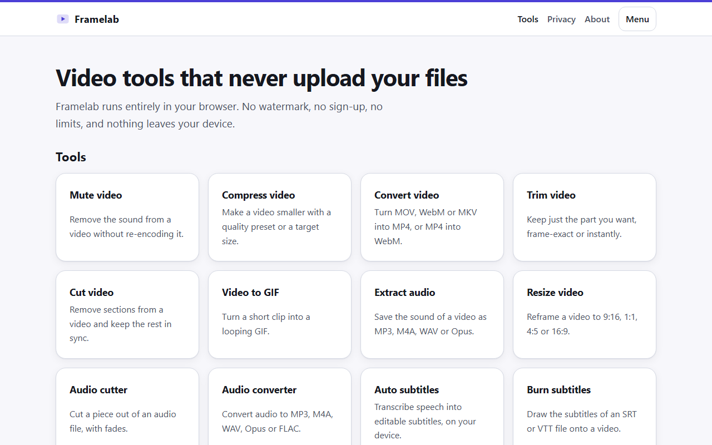
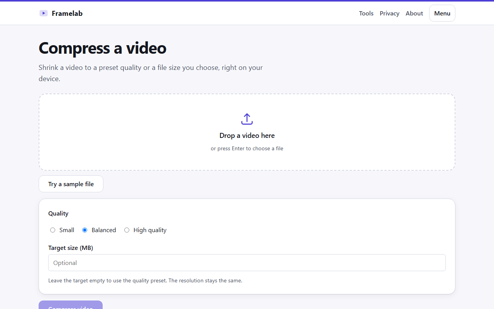
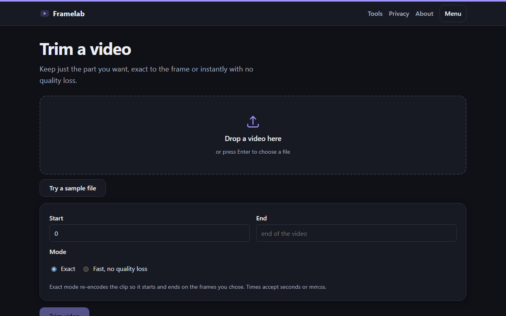
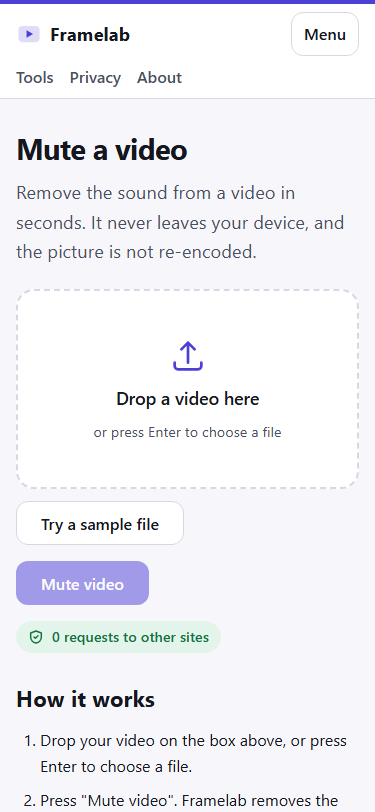

# Framelab

Free video and audio tools that run entirely in your browser: no upload, no watermark, no sign-up and no limits.
Media is read and written on your device with WebCodecs, through [Mediabunny](https://github.com/Vanilagy/mediabunny).



## What it does

17 tool pages, each with the tool above the fold:

- **Video:** compress, convert (plus MOV to MP4, WebM to MP4, MP4 to WebM), trim (frame-exact or instant), cut out
  sections, resize and crop (9:16, 1:1, 4:5, 16:9 or free), video to GIF, mute.
- **Audio:** extract audio (MP3, M4A, WAV, Opus; plus video to MP3), audio cutter with fades, audio converter.
- **Subtitles:** auto subtitles (Whisper speech recognition on your device, with an editor, SRT/VTT export and
  burn-in) and burn an existing SRT/VTT file into a video.

Comfort features: "Try a sample file" in every empty tool, drop a file anywhere on a page, a before/after size and
length summary after each export, "Use the result in another tool" (the file moves between tools inside your browser),
a keyboard shortcuts sheet (press `?`), light and dark themes (Menu, or `D`), a reduced-motion path, and installation
as an app that works offline after the first visit.

| Compress, light | Trim, dark | Mute, 375 px wide |
|---|---|---|
|  |  |  |

## Privacy model

- **Files never leave your device.** Every tool decodes, edits and encodes inside the page (a dedicated worker).
  There is no upload endpoint at all.
- **No requests to other sites.** The CSP is `default-src 'self'` with `connect-src 'self'`, and every page shows a
  live "0 requests to other sites" badge fed by the browser's own resource timing. The e2e suite asserts 0
  cross-origin requests on every page and after a tool flow (E2, E39).
- **Speech models only on consent.** Auto subtitles downloads a Whisper model only after you accept its size. Models
  are served from Framelab's own origin, kept in your browser's cache, and can be deleted from the tool. The offline
  cache (service worker) never includes the models.
- **No analytics, cookies, ads or accounts.** The hand-off between tools uses IndexedDB in your browser and is
  deleted as soon as the next tool reads it.

## Browser support

Measured by the Playwright suite on 22 November 2026 (Windows 11, `npx playwright test --workers=1`):

| Browser (Playwright project) | What was run | Result |
|---|---|---|
| Microsoft Edge (`msedge`) | everything: every tool, offline, hand-off, shortcuts, axe, isolation | all pass (Lighthouse E35 deferred, see below) |
| Bundled Chromium (`chromium`) | `@cross` cases: axe light/dark, isolation, network proof, capability banner, MP4 fallback | all pass |
| Firefox (`firefox`) | the same `@cross` cases | all pass (one Chromium-only case skipped) |
| WebKit (`webkit`) | `@smoke`: pages load cross-origin isolated | pages pass; the mute flow fails because Playwright's Windows WebKit build has no WebCodecs, so the tool shows its "not supported in this browser" notice |

Edge (and Chrome) have the proprietary H.264/AAC encoders, so MP4 output uses them directly; bundled Chromium
offers WebM with a reason instead. Browsers without WebCodecs get a clear notice that points to a recent Chrome,
Edge, Safari or Firefox. Real Safari was not measured here.

## Stack

- Astro 5 (static output) with Svelte 5 islands and TypeScript (strict)
- Mediabunny + WebCodecs in a dedicated module worker (`src/engine/`); transformers.js + ONNX Runtime Web for speech
- A hand-written service worker (`scripts/sw.mjs`) and sitemap endpoint: no extra dependencies
- Cloudflare Pages hosting; COOP/COEP and a strict hash-based CSP in `public/_headers`

## Run and test

```sh
npm install
npm run dev          # local dev server
npm run build        # static build into dist/ (also writes dist/sw.js)
npm run preview      # serve dist/ with the _headers rules applied (port 4799)
npm run check-dist   # file-size, absolute-URL, CSP-hash and header checks on dist/
npm test             # unit tests (vitest)
npx playwright test --workers=1                    # e2e tests against the built site, all projects
npx playwright test --workers=1 --project=msedge   # the full e2e set in Edge only
node scripts/fetch-test-model.mjs                  # the tiny Whisper model for the real-speech test (E30)
npm run fixtures     # regenerate the tiny test media in tests/fixtures/ (needs a local ffmpeg CLI)
npm run lh           # Lighthouse on /, /compress-video, /auto-subtitles (needs `npm i -D lighthouse`)
node scripts/og-images.mjs        # re-render the Open Graph images and app icons (committed PNGs)
node scripts/screenshots.mjs --readme   # re-take the README screenshots (serve dist/ first)
```

Lighthouse is not installed yet (disk space), so E35 (the Lighthouse thresholds) is deferred and fails with
"Lighthouse is not installed".

## Licence

© Arpan Mandal. All Rights Reserved. See `COPYRIGHT`. Third-party components keep their own licences; see
`THIRD_PARTY_LICENSES.md` and the `/licenses` page.
